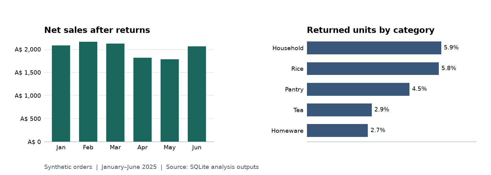

# Retail sales and customer baskets

Which products drive sales after returns, and do the same shoppers spend more online or in store? This portfolio case follows 300 synthetic orders from January to June 2025. All amounts are in Australian dollars. The data and implementation were prepared with AI assistance for this demonstration.

## Findings

| Question | Result | Decision in this scenario |
| --- | --- | --- |
| Where are sales concentrated? | Of 300 orders, 290 were paid. After returns, net sales were $12,038.50. Homeware accounted for $6,649, or 55.2%. | Check homeware availability before expanding the range. Sales alone cannot establish profitability. |
| Are returns concentrated? | Household had 10 returned units out of 169 sold. Rice also had 10, out of 172. | Inspect both categories' return reasons before prioritising one. |
| Do the same shoppers spend more online? | Among 46 customers who used both channels, the average within-customer difference was +$2.22 per basket. Its 95% bootstrap interval ran from −$5.64 to +$10.29. | The interval includes zero. Collect more observations before basing a channel pricing decision on this difference. |



## Open the Power BI report

Download [the Power BI Desktop project](retail-power-bi.zip), extract the ZIP and open `Retail.pbip` in Power BI Desktop. Select **Home → Refresh** to load the published monthly and category SQL outputs. If prompted for web credentials, choose **Anonymous** for raw.githubusercontent.com. Each chart uses its own summary table. The two tables aggregate the orders at different levels.

## Reproduce the analysis

Download the repository. In its root folder run the following with Python 3 and base R.

```sh
python run.py
Rscript --vanilla baskets.R
```

[SQL analysis](analysis.sql) · [Python runner and validation](run.py) · [R analysis](baskets.R)

The SQL cleans inconsistent text, removes six duplicate lines, joins product records, excludes cancellations and reconciles returned units in integer cents before reporting dollars. Window functions identify each customer’s successive orders and calculate monthly sales growth.

| Output | How to read it |
| --- | --- |
| [Monthly sales](monthly_sales.csv) | Gross sales, refunds and net sales by calendar month. June net sales rebounded 15.33% from May to $2,060.40. |
| [Category sales](category_sales.csv) | Compare category revenue and unit returns using the reported denominators. |
| [Repeat customers](repeat_customers.csv) | In June, 39 of 40 active customers made at least one repeat purchase. Repeat means a prior paid order visible within this six-month sample. |
| [Customer baskets](customer_baskets.csv) and [interval](basket_interval.csv) | The R script pairs each customer's average online and in-store net baskets. It resamples customers 5,000 times with seed 5840. Each eligible customer receives equal weight. |

## Scope

[Order lines](order_lines.csv) and [products](products.csv) are generated fixtures. The fixed customer pool and six-month observation window affect repeat rates. Shoppers appearing for the first time may already have purchased before January. The paired comparison describes multichannel shoppers in this sample. It cannot establish a causal effect or support conclusions about an actual retailer.
